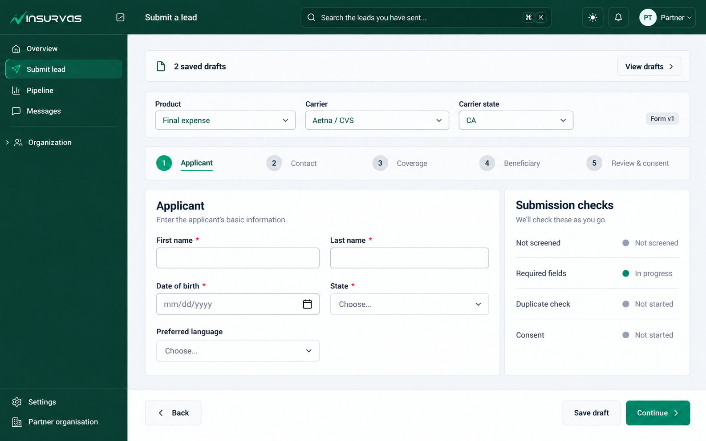
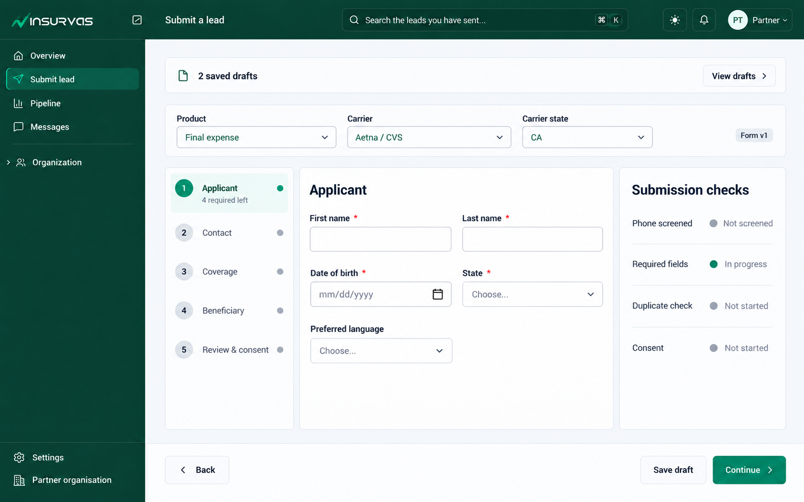

# Partner “Submit a lead” — UX review and mockups

**Purpose:** Review the current partner lead-submission experience and compare two layout directions. The user selected Direction A for implementation. Mockup values are illustrative; implementation follows the shared design system and preserves the existing workflow rules.

## Recommendation

Use **Direction A: Guided application** as the starting point. The core job is to submit a screened, compliant lead safely. A guided flow keeps attention on the current section, makes progress legible, and reserves consent for the final review. Keep the submission checks visible on wide screens, but make them a compact disclosure on narrow screens.

Keep Direction B as an alternative if partners need to jump frequently among sections. Its persistent section navigator helps orientation, but the three-column layout is denser and needs careful collapse behavior at tablet widths.

This is a data-entry and compliance workflow, so charts and decorative metric cards would add noise. Use concise status labels, clear next actions, field-level validation, and a small number of meaningful progress cues.

## What the current page is doing

The page has several real responsibilities beyond collecting fields:

- Select an approved product and an available carrier/state market.
- Screen a phone number before the lead form opens.
- Collect a template-driven form whose fields and section count can vary.
- Record express contact consent and supporting compliance checks.
- Save and resume drafts; verify possible duplicates and require a reason when needed.
- Submit only when partner status, screening, required fields, duplicate handling, and consent meet the rules.

The current screenshot is already in the post-screening state: the Applicant section is active, the page reports four required fields left in that section, consent is checked, and the right rail reports overall progress and screening/duplicate status. It also shows two saved drafts above the form. Those states should be designed intentionally rather than treated as exceptional content.

## Main opportunities

1. **Keep drafts from pushing the task below the fold.** The expanded draft list grows with every saved lead. Show a compact count and a “View drafts” action, then open a drawer or popover with resume/discard actions. Preserve an obvious indicator for the draft currently open below.
2. **Use one clear progress model.** The current section navigation, “Section 1 of 4”, per-section required count, and overall percentage can compete. Keep section names and current position as the primary progress signal; use the percentage only as a supporting summary, with a stable definition across templates.
3. **Move consent to an intentional review moment.** Consent is legally meaningful and should remain explicit, unchecked by default, and easy to revisit. Prefer one final Review & consent step, with a concise summary of the lead and consent language before submission, rather than repeating the checkbox alongside early-section fields.
4. **Protect entered work during destructive transitions.** Changing product or market clears answers; discarding a draft deletes it. Keep the selector row compact and free of blanket helper copy (as requested), but when answers exist, confirm the specific change and explain that it clears them. Offer an undo for draft discard if the underlying flow allows it.
5. **Make the phone-screening action visually secondary to the field.** Align the compact button to the phone input baseline, but do not stretch it to the input’s full width or height. Keep pending, success, warning, blocked, and retry states close to the number.
6. **Keep readiness useful on long forms.** A right rail can help on desktop, but should stay compact and avoid repeating the stepper. On mobile, collapse it into a “Submission checks” summary with status and counts, so it does not bury the active fields.
7. **Make save state visible and trustworthy.** Distinguish “Saving…”, “Saved just now”, “Couldn’t save — retry”, and draft-limit errors. Prevent navigation or switching drafts from silently losing keystrokes that are still waiting for autosave.
8. **Design final actions for the current step.** Keep Back, Save draft, and Continue/Submit in a consistent footer. On mobile, make the primary action easy to reach without covering fields or consent text.

These are design recommendations based on the screenshot and current implementation paths. They should be checked in the browser before implementation is considered complete.

## Mockup directions

### A — Guided application (recommended)

- Condenses saved drafts into one row; the full list opens only when requested.
- Keeps Product, Carrier, State, and Form version in a compact context row.
- Shows a short horizontal stepper and one section at a time.
- Keeps the readiness checklist as a narrow, scannable rail on desktop.
- Gives each section a consistent Back / Save draft / Continue action area.
- Uses a dedicated final Review & consent step, rather than mixing consent into Applicant.

**Best when:** most partners complete a lead from top to bottom and benefit from fewer simultaneous choices.

**Needs careful handling:** section names and counts are template-driven; the stepper must adapt without clipping or becoming an unusable row on small screens. If a section is conditional or disappears, preserve a sensible current location and recalculate progress from the visible required fields.

### B — Persistent section navigator

- Keeps the same compact draft and market rows.
- Adds a persistent in-form section list with completion state and required-left counts.
- Shows the selected section in the main form and submission checks in a side rail.
- Makes direct section review easier for people returning to a partially completed lead.

**Best when:** experienced partners often move back and forth, or forms are long enough that one horizontal stepper becomes hard to use.

**Trade-off:** three columns use significant width. Collapse the readiness rail first at intermediate widths, then move the section navigator above the form or into a compact section picker on mobile.

## Scenario coverage to preserve

### Entry and market selection

| Scenario | UI behavior to make clear |
|---|---|
| Products/markets are loading | Show a quiet loading state in the relevant control; avoid implying the account has no access yet. |
| No approved product | Explain the next useful action or who can enable one; keep the rest of the form unavailable. |
| Product exists but no carrier/state market is open | Explain that no market is available and provide the existing contact-agent route. |
| One product, one market | Preselect only if current product rules allow it; show the selected context plainly. |
| Several products/carriers/states | Searchable shared selects; long names truncate gracefully; state options depend on carrier and product access. |
| Market or product changes with no answers | Apply the selection directly and refresh the correct template. |
| Market or product changes with answers | Confirm the specific reset before clearing answers; retain the current draft if the user cancels. |
| Form is not ready or required phone configuration is missing | Explain the block in place and give the partner an actionable route; do not render a broken partial form. |

### Draft lifecycle

| Scenario | UI behavior to make clear |
|---|---|
| No drafts / one draft / many drafts | Hide empty chrome; keep one draft compact; use a drawer/list for multiple drafts so the active form stays in view. |
| Active draft is open below | Mark it “Open below”; do not offer a redundant resume action for the same active record. |
| Resume another draft | Preserve its saved template revision and answers; clearly indicate the active draft after switching. |
| Save in progress / saved / failed | Show truthful, local status near drafts or the footer; allow retry without losing entered values. |
| Draft limit reached | Explain the limit and available next actions; do not silently stop saving. |
| Discard draft | Confirm destructive deletion or offer undo; ensure the current draft cannot be deleted by an accidental click. |
| User types then immediately switches or leaves | Flush pending autosave or warn/retain local input; verify the debounce/unmount edge in browser. |

### Phone screening and compliance

| Scenario | UI behavior to make clear |
|---|---|
| Empty or malformed number | Inline error on the field and no screening request until input is valid. |
| Screening pending | Disable duplicate requests and show a compact, polite pending indicator. |
| Clear | Show a clear result and open the form; retain the screened number in the lead. |
| DNC warning requiring acknowledgement | State what needs acknowledgement and keep the user’s entered number and answers. |
| TCPA/compliance block | Make the stop unambiguous, avoid a submit path, and show only an allowed next step. |
| Network/server failure | Say the check could not be completed; offer retry without implying the number passed. |
| Phone number changes after a clear result | Require a fresh screen for the new number and invalidate prior clearance. |

### Template-driven form

| Scenario | UI behavior to make clear |
|---|---|
| Short vs. long template | Keep section navigation proportional; avoid a huge empty stepper for short forms. |
| Optional-only or completed section | Show completion without a false “required fields left” warning. |
| Conditional fields appear/disappear | Preserve relevant answers; remove hidden answers from submission as the current rules require; recalculate progress. |
| Different field types | Keep labels, required markers, help, and validation consistent for dates, selects, multi-selects, and derived values. |
| Validation error | Keep entered values, focus or link to the first error, and summarize errors in a location users can find. |
| Resume an older draft/template | Explain that the saved draft continues on its original form version if that remains the rule; do not silently reinterpret answers using a new template. |

### Duplicate check, consent, and submission

| Scenario | UI behavior to make clear |
|---|---|
| Duplicate check running / clear / unavailable | Separate “checking” from “no match”; if unavailable, explain whether submission is blocked or can be retried. |
| Possible duplicate | Show enough context to resolve it without exposing unnecessary personal data; request the required justification. |
| Duplicate found again on server submit | Preserve the form and justification; return the user to the resolution step. |
| Consent unchecked | Keep Submit disabled and identify the consent step/action needed. Never precheck consent. |
| Consent checked | Show a clear captured state and timestamp behavior consistent with the audit record. |
| Partner becomes inactive or paused | Explain why submission cannot proceed and preserve the draft. |
| Submit pending / failed / success | Prevent duplicate submission; preserve answers on failure; show a clear success confirmation and next action. |

### Responsive behavior

- **Wide desktop:** current step and checks can sit side by side; keep the main form readable, not stretched across the full viewport.
- **Tablet:** collapse the checks rail before shrinking inputs; place section navigation in a compact row or selector.
- **Mobile:** single-column form, compact market context, drafts in a drawer, checks behind a summary disclosure, and a reachable action footer. Avoid sticky controls that cover consent wording or validation errors.
- **Keyboard and assistive tech:** every step must have a clear heading; progress should be announced meaningfully; errors must be associated with fields; section changes should move focus predictably without losing answers.

## Open risks to verify before implementation

1. **Autosave transition timing:** draft writes are debounced. A route/key change before the pending write completes may cancel the timer and drop the latest keystrokes. This is a code-path risk to verify, not a confirmed browser failure.
2. **Discard is destructive:** verify whether the current discard action has a confirmation/undo path and make deletion status clear.
3. **Progress definition:** confirm whether the right-rail percentage counts required fields only, all fields, or sections; keep one definition for templates with optional/conditional fields.
4. **Consent placement:** confirm product/compliance requirements permit a final review step while preserving the same explicit affirmative action and audit timestamp. The design should not alter consent semantics.
5. **Responsive checks:** verify long section names, many sections, long market names, and validation summaries at the app’s actual supported widths.
6. **Template behavior:** confirm how hidden conditional answers are pruned and how an old saved template version is rendered before changing step navigation.

## Research notes

- The W3C multi-page form tutorial recommends dividing long forms into logical steps and orienting people to their progress. [W3C: Multi-page forms](https://www.w3.org/WAI/tutorials/forms/multi-page/)
- USWDS describes step indicators as a fit for linear processes with three or more steps, with concise labels and separate navigation controls. [USWDS: Step indicator](https://designsystem.digital.gov/components/step-indicator/)
- GOV.UK advises using progress indicators only when useful, keeping them simple, and ensuring totals stay accurate as a form changes. [GOV.UK: Question pages](https://design-system.service.gov.uk/patterns/question-pages/)
- W3C recommends making errors easy to find and understand while retaining user-entered values. [W3C: Form notifications](https://www.w3.org/WAI/tutorials/forms/notifications/)

## Review boundary

Direction A was selected and implementation has started. The live page now uses a condensed draft entry point, a saved-drafts sheet, dynamic form steps with a dedicated Review & consent step, and a final answer summary. Existing screening, validation, duplicate handling, consent, and submission gates remain in place.
